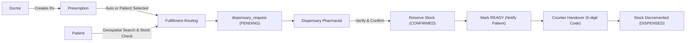
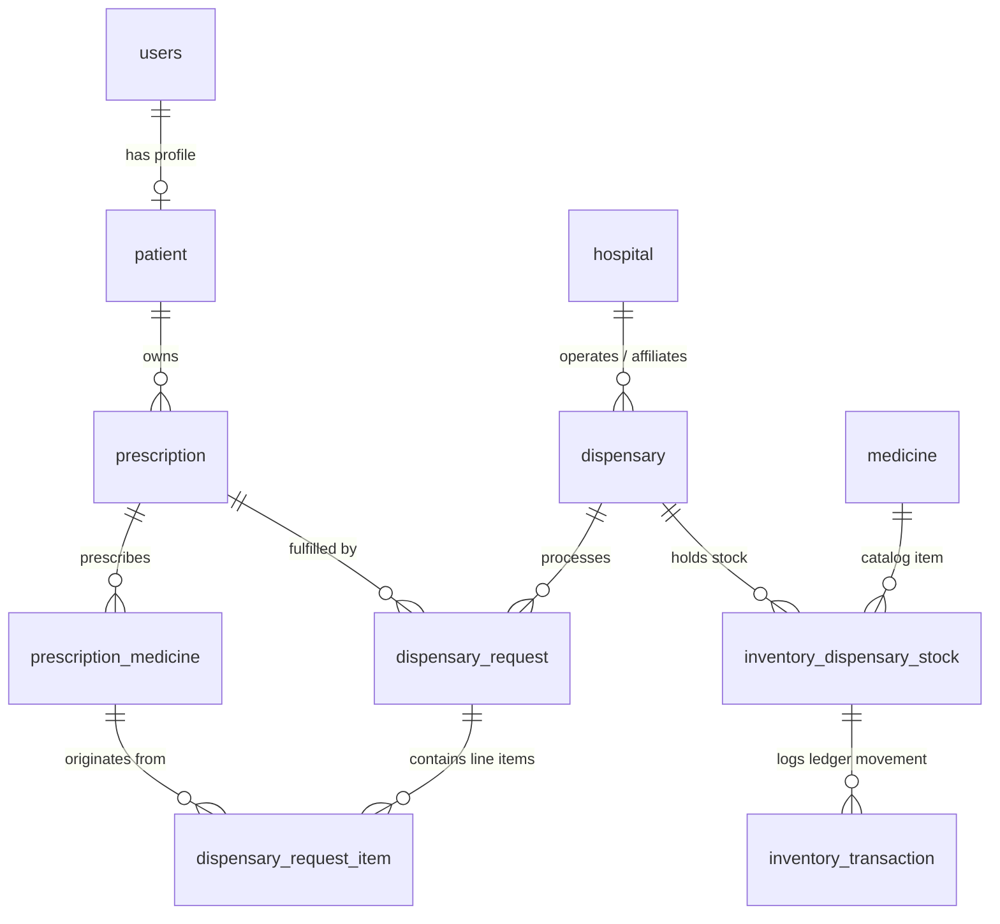
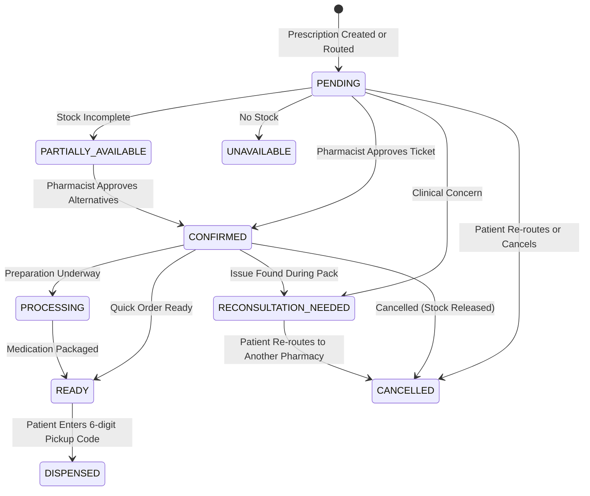

# Patient $\rightarrow$ Dispensary System Architecture & Feature Guide

> **Scope**: Educational walkthrough of how the **Patient** and **Dispensary** domains interact in **Rxify (PRO-JET)**, covering database architecture, algorithmic logic, backend services, API contracts, and the patient/pharmacist UI workflows.

---

## 1. Executive Summary & Core Concept

In a traditional healthcare setup, a patient receives a paper prescription from a clinic and searches for a pharmacy that stocks their exact medications. 

In this repository, the **Patient $\leftrightarrow$ Dispensary** relationship is modeled as a **decoupled, event-driven fulfillment workflow**:
1. A **Patient** does not permanently "belong" to a single dispensary. Instead, a dispensary acts as an independent fulfillment organization (either hospital-affiliated or standalone).
2. When a doctor writes a prescription for a patient, an electronic ticket (`dispensary_request`) is initialized.
3. The patient can use **Geospatial Discovery** to find nearby pharmacies within a radius, check real-time stock availability, review bioequivalent generic alternatives, and route the prescription to their chosen dispensary.
4. The dispensary operates a **FIFO fulfillment queue**, reviews clinical safety (dosage, drug interactions), confirms the ticket, and **atomically reserves inventory**.
5. When ready, the patient receives a notification, visits the counter, and provides a **6-digit cryptographic pickup code** or QR code. The pharmacist enters the code, the physical stock is deducted in an atomic database transaction, and the order is marked `DISPENSED`.
6. If an issue arises (e.g., severe contraindication or total stock-out), the pharmacist flags a **Clinical Reconsultation Advisory**, automatically pausing fulfillment and routing the patient back to their prescribing doctor.



---

## 2. Relational Database Architecture

The relationship between patients and dispensaries is mediated through three primary layers: **Identity**, **Prescriptions**, and **Fulfillment Tickets**.

Defined in [`database/db.py`](file:///c:/CODING%20ONLY/PRO-JET/database/db.py):



### Key Tables & Schema Breakdown

| Table Name | Role & Description | Key Columns |
| :--- | :--- | :--- |
| **`patient`** | Patient demographic profile tied to `users.user_id`. | `patient_id`, `user_id`, `patient_code` (e.g. `RXF-P-ABC12`), `date_of_birth` |
| **`dispensary`** | Authenticated organization account (like a hospital entity). | `dispensary_id`, `hospital_id`, `name`, `email`, `location`, `latitude`, `longitude`, `operating_hours`, `avg_prep_minutes`, `status` |
| **`prescription`** | The medical order signed by a licensed doctor. | `prescription_id`, `patient_id`, `doctor_id`, `clinic_id`, `diagnosis`, `issue_date` |
| **`prescription_medicine`**| Prescribed items (original doctor instructions). | `prescription_medicine_id`, `prescription_id`, `medicine_id` (FK to master catalog), `dosage`, `frequency`, `duration` |
| **`inventory_dispensary_stock`** | Pharmacy-specific stock level. | `inventory_id`, `dispensary_id`, `medicine_id`, `available_quantity`, `reserved_quantity`, `reorder_level` |
| **`dispensary_request`** | The fulfillment ticket connecting patient, prescription, and dispensary. | `request_id`, `prescription_id`, `dispensary_id`, `patient_id`, `status`, `estimated_ready_at`, `pickup_code`, `pharmacist_notes` |
| **`dispensary_request_item`** | Line-item fulfillment status per medicine. | `item_id`, `request_id`, `prescription_medicine_id`, `medicine_id`, `required_quantity`, `dispensed_quantity`, `availability_status`, `reserved`, `suggested_substitute_id` |
| **`inventory_transaction`** | Immutable audit trail of every stock modification. | `txn_id`, `inventory_id`, `dispensary_id`, `medicine_id`, `txn_type`, `quantity`, `reference_id` |

---

## 3. Core Features & Algorithms

### Feature 1: Geospatial Discovery & Smart Matching
When a patient wants to pick up their medication, they open the **Find Dispensaries** tab.

- **Endpoint**: `GET /api/patient/dispensaries/nearby` in [`routers/patient.py`](file:///c:/CODING%20ONLY/PRO-JET/routers/patient.py#L427)
- **Service Function**: `find_nearby_dispensaries(...)` in [`services/dispensary_search.py`](file:///c:/CODING%20ONLY/PRO-JET/services/dispensary_search.py#L131)

#### 1. Haversine Proximity Calculation
The backend calculates the spherical great-circle distance (in kilometers) between the patient's device coordinates and every active dispensary with registered GPS:
$$\Delta\phi = \phi_2 - \phi_1, \quad \Delta\lambda = \lambda_2 - \lambda_1$$
$$a = \sin^2\left(\frac{\Delta\phi}{2}\right) + \cos(\phi_1)\cos(\phi_2)\sin^2\left(\frac{\Delta\lambda}{2}\right)$$
$$d = 2 \cdot R \cdot \text{atan2}\left(\sqrt{a}, \sqrt{1-a}\right) \quad (\text{where } R = 6371\text{ km})$$

#### 2. Real-time Inventory Cross-Referencing & Generic Substitution
For each medicine prescribed in `prescription_medicine`:
1. Check if the exact catalog `medicine_id` exists in `inventory_dispensary_stock` with `available_quantity > 0`.
2. If the prescribed brand is **out of stock**, the query searches for a **generic bioequivalent alternative** stocked at that dispensary:
   ```sql
   SELECT m.medicine_id, m.brand_name, s.available_quantity
   FROM inventory_dispensary_stock s
   JOIN medicine m ON m.medicine_id = s.medicine_id
   WHERE s.dispensary_id = %s
     AND LOWER(m.generic_name) = LOWER(%s)
     AND s.medicine_id != %s
     AND s.available_quantity > 0
   LIMIT 1;
   ```
3. Classifies overall inventory status:
   - `ALL_AVAILABLE`: 100% of prescribed medicines in stock.
   - `PARTIALLY_AVAILABLE`: At least one item in stock or substitute available.
   - `NONE_AVAILABLE`: None in stock.
   - `AVAILABILITY_UNKNOWN`: Prescribed medicine unresolved to master catalog.

#### 3. Multi-Criteria Ranking Algorithm
Dispensaries are scored on a scale from $0$ to $100$:
$$\text{Rank Score} = (w_{\text{avail}} \times S_{\text{avail}}) + (w_{\text{dist}} \times S_{\text{dist}}) + \text{Bonus}$$

- When a prescription is active:
  - **Availability Weight ($w_{\text{avail}}$)** = $0.65$ (Stock availability is top priority)
  - **Distance Weight ($w_{\text{dist}}$)** = $0.35$
- Proximity score decays hyperbolically:
  $$S_{\text{dist}} = \frac{100}{1 + 0.15 \times \text{distance\_km}}$$
- Operational bonuses are added: $+3.0$ points for 24/7 pharmacies, $+2.0$ points for pharmacies with fast turnaround ($\le 10$ minutes prep time).
- Dispensaries are sorted descending by score and tagged with badges: **"Top Recommendation"**, **"Runner-Up Match"**, or **"Top Alternative"**.

---

### Feature 2: Patient-Driven Fulfillment Routing & AI Fallback
When a patient clicks **"Select & Send to Dispensary"**:

- **Endpoint**: `POST /api/patient/dispensary/fulfill` in [`routers/patient.py`](file:///c:/CODING%20ONLY/PRO-JET/routers/patient.py#L447)
- **Service Function**: `route_prescription_fulfillment(...)` in [`services/dispensary_search.py`](file:///c:/CODING%20ONLY/PRO-JET/services/dispensary_search.py#L437)

#### Logic Flow:
1. **Ownership & Security Verification**: Ensures `patient_user_id` matches the prescription owner.
2. **Order Transfer & Prior Ticket Cleanup**: If the prescription had pending tickets at another pharmacy, they are marked `CANCELLED` with a transfer note:
   ```sql
   UPDATE dispensary_request
   SET status = 'CANCELLED',
       notes = COALESCE(notes, '') || ' [Transferred to ' || %s || ']'
   WHERE prescription_id = %s AND dispensary_id != %s AND status IN ('PENDING', 'PARTIALLY_AVAILABLE', 'UNAVAILABLE');
   ```
3. **Queue ETA Calculation**:
   Estimates pickup time based on current backlog:
   $$\text{ETA (minutes)} = (\text{queue\_position} \times \text{avg\_prep\_minutes}) + \text{avg\_prep\_minutes}$$
   $$\text{estimated\_ready\_at} = \text{NOW}() + \text{ETA}$$
4. **Secure Handover Code Generation**:
   Generates a cryptographically strong 6-digit random code using Python's `secrets` module:
   ```python
   pickup_code = f"{secrets.randbelow(900000) + 100000}"
   ```
5. **Fast AI Fallback Resolution**:
   If an OCR-scanned prescription contains ambiguous or unreviewed drug names, [`services/ai_medicine_fallback.py`](file:///c:/CODING%20ONLY/PRO-JET/services/ai_medicine_fallback.py) automatically resolves or generalizes them before the order hits the pharmacist's queue.
6. **Notification Delivery**:
   Inserts an in-app notification row into the `notification` table for the patient.

---

### Feature 3: Dispensary Queue, Verification & Stock Reservation
The dispensary staff accesses their dashboard at [`better-frontend/src/pages/dispensary/DispensaryPortal.tsx`](file:///c:/CODING%20ONLY/PRO-JET/better-frontend/src/pages/dispensary/DispensaryPortal.tsx).

- **Endpoints**: [`routers/dispensary.py`](file:///c:/CODING%20ONLY/PRO-JET/routers/dispensary.py)
- **Service**: [`services/dispensary.py`](file:///c:/CODING%20ONLY/PRO-JET/services/dispensary.py)

#### 1. Instant Patient / Prescription Code Lookup
The pharmacist can type or barcode-scan:
- `RXF-P-XXXXX` $\rightarrow$ Patient ID lookup
- `RXF-RX-XXXXX` $\rightarrow$ Prescription ID lookup
- Ticket ID $\rightarrow$ Direct request lookup

#### 2. Clinical Pharmacist Verification
Before dispensing, the pharmacist reviews clinical criteria via `POST /api/dispensary/requests/{id}/verify`:
- Patient identity verified
- Dosage validity checked
- Drug-drug interactions cleared
- Generates a clinical digital audit stamp: `RXF-V-{request_id}-{dispensary_id}-{timestamp}`.

#### 3. Ticket Approval & Atomic Stock Reservation
When the pharmacist clicks **Approve & Confirm** (`confirm_or_approve_request`):
- Uses PostgreSQL row-locking (`FOR UPDATE`) on `inventory_dispensary_stock` to prevent race conditions.
- Available stock is not consumed yet; instead, `reserved_quantity` increases:
  ```sql
  UPDATE inventory_dispensary_stock
  SET reserved_quantity = reserved_quantity + %s,
      updated_at = NOW()
  WHERE inventory_id = %s;
  ```
- An immutable entry is written to `inventory_transaction`:
  `txn_type = 'MEDICINE_RESERVED'`.
- Status transitions to `CONFIRMED` and the patient's app updates immediately with the confirmed ETA.

#### 4. Item-Level Decision Overrides
If a specific medicine needs substitution or has partial quantity, the pharmacist can make per-item adjustments via `PATCH /api/dispensary/requests/{id}/items/{item_id}`:
- `FULFILL`: Full allocation.
- `PARTIAL`: Allocates available units.
- `SUBSTITUTE`: Substitutes with generic medicine ID, shifts reservation.
- `UNAVAILABLE`: Marks item missing.
- `RECONSULT`: Flags item for doctor consultation.

---

### Feature 4: The Clinical Reconsultation Loop
When an issue is flagged (e.g. prescribed drug conflicts with patient history or is discontinued):

- **Service Function**: `request_reconsultation(...)` in [`services/dispensary.py`](file:///c:/CODING%20ONLY/PRO-JET/services/dispensary.py#L823)

1. The pharmacist enters mandatory clinical advisory notes and selects a target (`DOCTOR` or `PATIENT`).
2. Any reserved stock is immediately **released back into free stock** (`reserved_quantity` decremented) so medications are not trapped.
3. The ticket status transitions to `RECONSULTATION_NEEDED`.
4. In the Patient Portal ([`DispensaryTab.tsx`](file:///c:/CODING%20ONLY/PRO-JET/better-frontend/src/pages/patient/tabs/DispensaryTab.tsx#L104)), an alert banner appears:
   - Displays the pharmacist's advice: *"Pharmacist Advises Doctor Reconsultation"*.
   - Provides a **"Consult Prescribing Doctor"** quick action button that triggers an in-app message switch event.
   - Provides a **"Cancel & Choose Other Dispensary"** button allowing the patient to re-route elsewhere.

---

### Feature 5: Counter Handover & Physical Stock Deduction
When the medication is assembled:

1. **Mark Ready**: Pharmacist clicks **"Mark Ready"** (`mark_request_ready`). Status becomes `READY`. Patient receives an alert: *"Your medicines are READY for collection from [Location]!"*
2. **Patient Arrival & QR Code**: Patient arrives at the counter and displays the **6-digit Pickup Code** or QR code generated on their ticket.
3. **Dispense Execution**:
   - Pharmacist inputs the 6-digit code via `POST /api/dispensary/requests/{id}/dispense`.
   - The backend validates the code against `dispensary_request.pickup_code`.
   - **Atomic Stock Deduction**:
     ```sql
     UPDATE inventory_dispensary_stock
     SET available_quantity = available_quantity - %s,
         reserved_quantity = reserved_quantity - %s,
         updated_at = NOW()
     WHERE inventory_id = %s;
     ```
   - Logs `inventory_transaction` with type `MEDICINE_DISPENSED`.
   - Writes to `audit_log` with action `DISPENSE_MEDICINE`.
   - Request status transitions to `DISPENSED`.
   - Patient receives confirmation that medicines were collected.

---

## 4. State Machine / Lifecycle Diagram

The ticket status transitions through the following lifecycle:



---

## 5. Summary of Key Files & Roles

| Module / File | Responsibility |
| :--- | :--- |
| [`database/db.py`](file:///c:/CODING%20ONLY/PRO-JET/database/db.py) | Database connections, migrations, triggers (`trg_generate_patient_code`), schema for `dispensary`, `inventory_dispensary_stock`, `dispensary_request`. |
| [`models/dispensary.py`](file:///c:/CODING%20ONLY/PRO-JET/models/dispensary.py) | Pydantic validation schemas for location, stock management, verification sign-offs, and dispense requests. |
| [`services/dispensary_search.py`](file:///c:/CODING%20ONLY/PRO-JET/services/dispensary_search.py) | Haversine distance, stock cross-referencing, multi-criteria ranking algorithm, and fulfillment routing. |
| [`services/dispensary.py`](file:///c:/CODING%20ONLY/PRO-JET/services/dispensary.py) | Core transactional logic: stock reservations, FIFO queue, clinical verification, reconsultations, and atomic dispensing. |
| [`services/inventory_availability.py`](file:///c:/CODING%20ONLY/PRO-JET/services/inventory_availability.py) | Read-only inventory queries across single or multi-medicine prescriptions. |
| [`services/ai_medicine_fallback.py`](file:///c:/CODING%20ONLY/PRO-JET/services/ai_medicine_fallback.py) | Resolves uncataloged or ambiguous OCR medicines before dispensary queue entry. |
| [`routers/patient.py`](file:///c:/CODING%20ONLY/PRO-JET/routers/patient.py) | Patient endpoints: `/dispensaries/nearby`, `/dispensary/fulfill`, `/dispensary-requests`, `/dispensary-requests/{id}/cancel`. |
| [`routers/dispensary.py`](file:///c:/CODING%20ONLY/PRO-JET/routers/dispensary.py) | Dispensary endpoints: `/inventory`, `/queue`, `/requests/{id}/approve`, `/requests/{id}/dispense`, `/lookup/{code}`. |
| [`better-frontend/src/pages/patient/tabs/DispensaryTab.tsx`](file:///c:/CODING%20ONLY/PRO-JET/better-frontend/src/pages/patient/tabs/DispensaryTab.tsx) | Patient UI: live ticket cards, countdown ETAs, QR & 6-digit pickup code, reconsultation warning banner, cancellation. |
| [`better-frontend/src/pages/patient/tabs/FindDispensariesTab.tsx`](file:///c:/CODING%20ONLY/PRO-JET/better-frontend/src/pages/patient/tabs/FindDispensariesTab.tsx) | Patient UI: GPS distance search, stock match %, bioequivalent alternatives, ranking badges, and order dispatch. |
| [`better-frontend/src/pages/dispensary/DispensaryPortal.tsx`](file:///c:/CODING%20ONLY/PRO-JET/better-frontend/src/pages/dispensary/DispensaryPortal.tsx) | Pharmacist UI: queue processing, inventory stock management, code scanner, verification checklists, and dispensing. |
| [`better-frontend/src/components/common/QrScannerModal.tsx`](file:///c:/CODING%20ONLY/PRO-JET/better-frontend/src/components/common/QrScannerModal.tsx) | Camera-based QR/barcode scanner used by pharmacists to scan `RXF-P-...` and `RXF-RX-...` codes. |
| [`better-frontend/src/lib/patientApi.ts`](file:///c:/CODING%20ONLY/PRO-JET/better-frontend/src/lib/patientApi.ts) | Client-side API wrappers for nearby dispensary search, routing fulfillment, and fetching pickup tickets. |
| [`better-frontend/src/lib/dispensaryApi.ts`](file:///c:/CODING%20ONLY/PRO-JET/better-frontend/src/lib/dispensaryApi.ts) | Client-side API wrappers for dispensary queue actions, stock controls, and prescription verification. |
