# Software Requirements Specification (SRS) & System Architecture
**Project:** Rxify — Intelligent Healthcare & Medication Management Platform  
**Architecture Paradigm:** Object-Oriented Domain-Driven Design (Service-Repository Pattern)  
**Status:** Living Engineering Reference  

---

## 1. System Vision & Architecture Overview

### 1.1 Purpose
Rxify is a modular platform connecting four healthcare domains: **Patients**, **Doctors/Hospitals**, **Clinical AI Knowledge Engines**, and **Dispensary Pharmacies**.

### 1.2 Architectural Principles
1. **Single Responsibility & Cohesion:** Eliminate monolithic files (>1000 lines). Every file has a single purpose (Repository, Service, Domain Entity, or View Component).
2. **Class-Based Encapsulation (Service-Repository):**
   - **Repository Classes:** Manage database connections, query execution, transactions, and entity mapping.
   - **Service Classes:** Encapsulate business rules, security policies, and orchestrate repositories.
   - **Routers / Controllers:** Thin declarative layer translating HTTP/WebSocket requests to Service calls.
3. **Frontend Modularity:**
   - Strict maximum file size (< 150 lines per component).
   - Server state cached via React Query; ephemeral UI state in Zustand. Zero parallel reducers.

---

## 2. Module 1: Authentication & Identity Management

### 2.1 Domain Entities (`services/auth/domain.py`)
- `AuthUser`:
  - `user_id: int` (Primary Key)
  - `email: str` (Unique Login Identifier)
  - `role: str` (`PATIENT`, `DOCTOR`, `DISPENSARY`, `HOSPITAL`)
  - `password_hash: str` (Bcrypt hash)
  - `status: str` (`ACTIVE`, `SUSPENDED`)
  - `patient_id`, `doctor_id`, `dispensary_id`, `hospital_id` (Domain-specific foreign keys)
- `TokenPayload`: Decoded claims with embedded permissions and role IDs.
- `AuthResult`: Typed immutable outcome of a successful login handshake.

### 2.2 Repositories & Services
```
services/auth/
├── __init__.py           # Public exports
├── domain.py             # AuthUser, TokenPayload, AuthResult
├── password_service.py   # PasswordService (Bcrypt hashing & verification)
├── token_service.py      # TokenService (JWT generation & validation)
├── repository.py         # UserRepository (SQL data access for accounts)
└── auth_service.py       # AuthService (Orchestrator for login/register across all roles)
```

### 2.3 Authentication & Authorization Architectural Flow

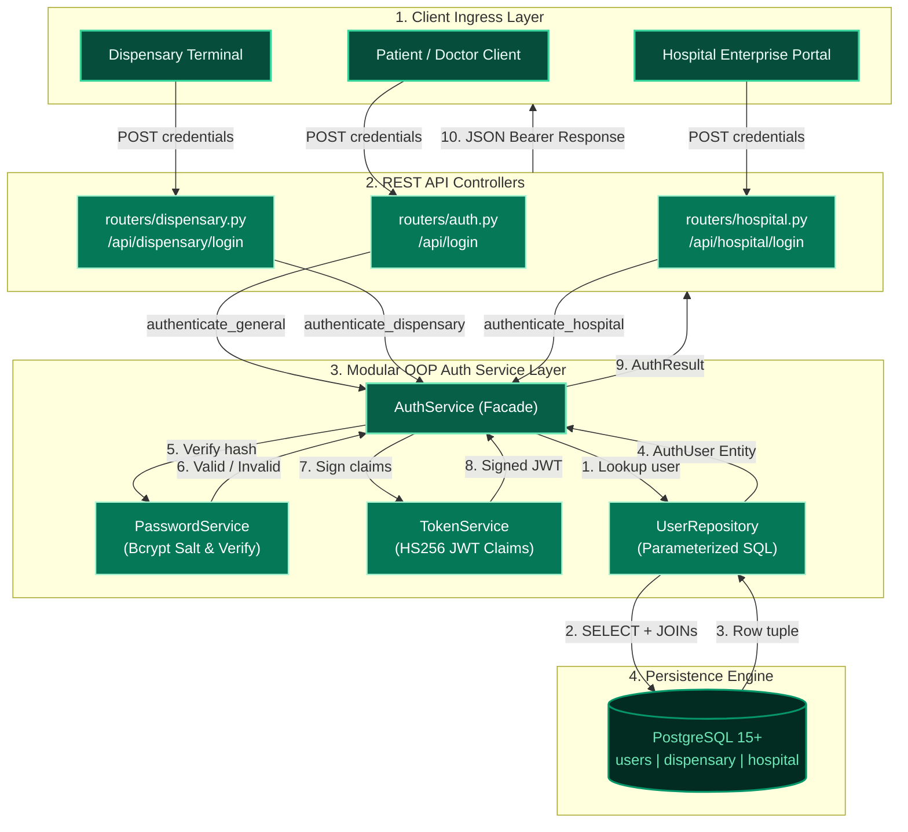

### 2.4 In-Depth Authentication Lifecycle Sequence

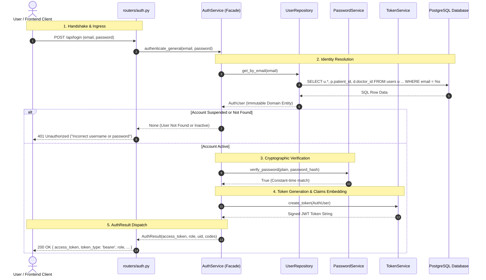

### 2.5 Protected Endpoint Authorization & Guard Lifecycle

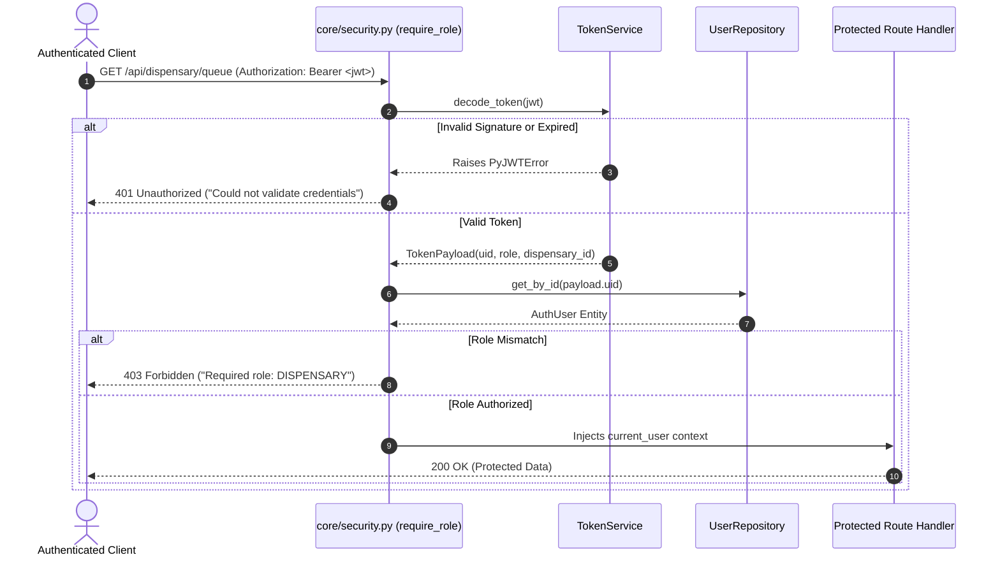

### 2.6 Endpoints Affected & Standardized

| Endpoint | Purpose | Handler Delegation |
| :--- | :--- | :--- |
| `POST /api/login` | General Patient & Doctor login | `default_auth_service.authenticate_general()` |
| `POST /api/register` | Patient & Doctor registration | `default_auth_service.register_user()` |
| `POST /api/dispensary/login` | Dispensary facility login | `default_auth_service.authenticate_dispensary()` |
| `POST /api/hospital/login` | Hospital enterprise login | `default_auth_service.authenticate_hospital()` |

---

## 3. Module 2: Prescription Intake & Clinical Ontology Normalization Engine

### 3.1 Domain Overview & Objectives
Rxify ingests prescriptions from multiple heterogeneous origins:
1. **Patient Mobile Uploads:** Optical Character Recognition (OCR) extractions from physical prescription paper slips.
2. **Doctor E-Prescription Portal:** Direct structured doctor orders.
3. **Hospital EHR Federated Sync:** HL7/FHIR medication statements.

Prescriptions commonly arrive with informal, regional brand names, dosage notations, and typos (e.g., *"Tab Crocin 650 TDS"*, *"Tylenol 500mg"*, *"Augmentin 625 Duo"*, *"Paracetamol BD"*). To ensure clinical safety, drug-drug interaction (DDI) checks, inventory availability, and dispensary fulfillment, every ingested drug string must be mapped to a canonical clinical concept (`medicine_id`, `rxcui`, `generic_name`).

### 3.2 Domain Entities (`services/clinical/domain.py` & `services/prescription/domain.py`)
- **`MatchStatus` (Enum):**
  - `MATCHED`: Successfully mapped to a single authoritative catalog item.
  - `AMBIGUOUS`: Multiple high-scoring candidates found (returned with top 3 ranked options).
  - `UNRESOLVED`: No confident match found (flagged for clinical review).
  - `NOT_A_MEDICINE`: Detected as dietary note, test instruction, or clinical noise.
- **`MatchCandidate`:**
  - `medicine_id: int`, `matched_name: str`, `rxcui: Optional[str]`, `confidence: float`, `method: str`, `form: Optional[str]`, `strength: Optional[str]`
- **`MatchResult`:**
  - Immutable outcome object containing `status`, `medicine_id`, `matched_name`, `confidence`, `method`, and ranked candidate lists.
- **`PrescriptionItem`:**
  - Line item inside a prescription: `raw_name`, `dosage`, `frequency`, `duration`, `instructions`, mapped `medicine_id`, and `match_status`.
- **`PrescriptionData`:**
  - Aggregate root for an ingested clinical document: `patient_id`, `issue_date`, `follow_up_date`, `diagnosis`, `notes`, and `medications: List[PrescriptionItem]`.

### 3.3 Repositories & Services Architecture
```
services/clinical/
├── __init__.py           # Public exports (MedicineMatcherService, default_matcher_service)
├── domain.py             # MatchStatus, MatchCandidate, MatchResult, ParsedMedication
├── synonyms.py           # SynonymBridge (BAN/IP/EP ↔ USAN/RxNorm international mapping)
├── normalizer.py         # ClinicalNormalizer (Token sanitization, form & strength parsing)
├── repository.py         # MedicineCatalogRepository (SQL parameterized queries + pg_trgm fuzzy matching)
└── matcher_service.py   # MedicineMatcherService (5-tier resolution orchestrator)

services/prescription/
├── __init__.py           # Public exports (PrescriptionService, default_prescription_service)
├── domain.py             # PrescriptionItem, PrescriptionData, PrescriptionRecord
├── parsers.py            # PrescriptionDateParser, DosageScheduleParser
├── repository.py         # PrescriptionRepository (CRUD operations on prescriptions, items & adherence)
└── prescription_service.py # PrescriptionService (Ingestion, clinical matching, timeline sync)
```

### 3.4 The 5-Tier Clinical Drug Resolution Pipeline

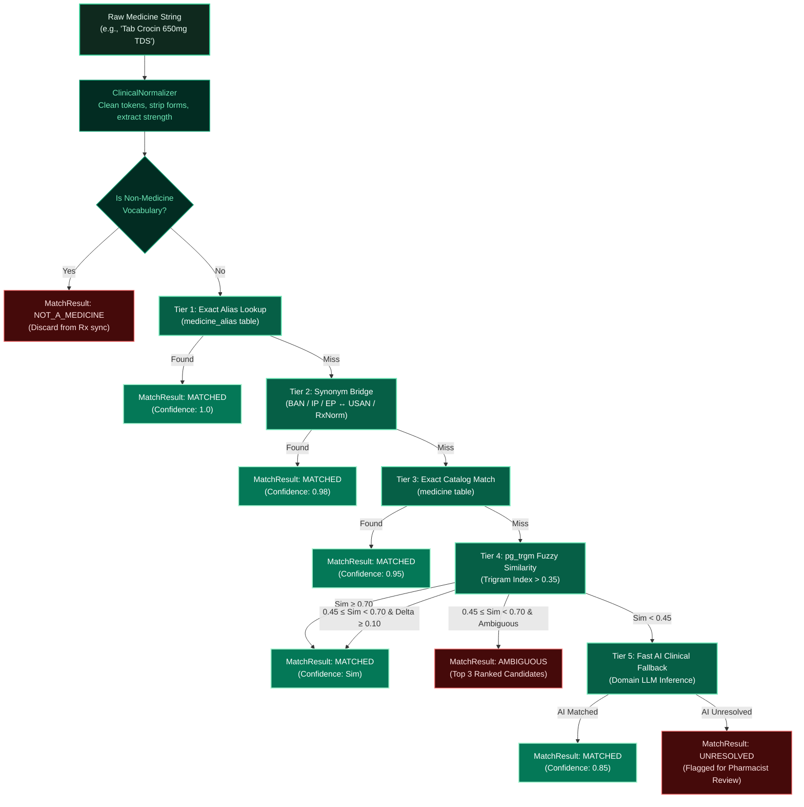

### 3.5 Prescription Ingestion & Active Adherence Sync Sequence

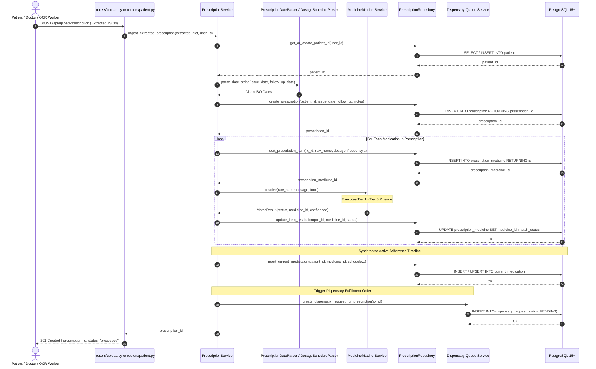

### 3.6 Endpoints & Service Delegations

| Endpoint | Purpose | Handler Delegation |
| :--- | :--- | :--- |
| `POST /api/upload-prescription` | Ingests OCR/Prescription JSON | `default_prescription_service.ingest_extracted_prescription()` |
| `GET /api/prescriptions/{id}/medicines` | Retrieves prescription items | `default_prescription_service.get_medicine_info()` |
| `POST /api/medicine/resolve` | Resolves raw medicine string | `default_matcher_service.resolve()` |
| `POST /api/medicine/resolve-batch` | Batch resolves drug strings | `default_matcher_service.resolve_batch()` |

---

## 4. Module 3: Dispensary Fulfillment & Inventory Stock Control

### 4.1 Domain Overview & Objectives
The Dispensary module transforms hospital pharmacies and independent dispensaries from isolated points of sale into intelligent fulfillment hubs:
1. **FIFO Ticket Fulfillment:** Prioritized queue automatically populated when clinical prescriptions are finalized.
2. **Deterministic Lifecycle Progression:** Multi-stage states (`PENDING` $\rightarrow$ `CONFIRMED` $\rightarrow$ `PROCESSING` $\rightarrow$ `READY` $\rightarrow$ `DISPENSED`).
3. **Atomic Stock Reservation:** Uses PostgreSQL `SELECT ... FOR UPDATE` row locks to guarantee zero double-allocation across parallel pharmacist terminals.
4. **Clinical Verification Sign-Off:** Digital checklist (patient identity, dosage limits, DDI clearance) with cryptographic signature before physical dispensing.
5. **Two-Factor Handover Verification:** 6-digit patient OTP verification preventing accidental medication release to wrong individuals.
6. **Reconsultation Advisory Loop:** Seamless escalation (`RECONSULTATION_NEEDED`) returning invalid or unfulfillable prescriptions to doctor/patient while immediately releasing locked inventory.
7. **Bi-Directional WebSocket Channel:** Real-time push updates via `dispensary_ws_manager` eliminating client-side polling loops.

### 4.2 Domain Entities (`services/dispensary/domain.py`)
- **`DispensaryProfile`:** Facility registry entity containing `dispensary_id`, `hospital_id`, `location`, GPS coordinates (`latitude`, `longitude`), and operating hours.
- **`StockItem`:** Inventory entity tracking `available_quantity`, `reserved_quantity`, computed `free_stock` (`available - reserved`), `reorder_level`, and `stock_status` (`NORMAL`, `LOW_STOCK`, `OUT_OF_STOCK`).
- **`DispensaryRequestItem`:** Line item tracking required vs. dispensed quantity, stock availability, substitute recommendations (`suggested_substitute_id`), and pharmacist decisions (`FULFILL`, `PARTIAL`, `SUBSTITUTE`, `UNAVAILABLE`, `RECONSULT`).
- **`DispensaryOrder`:** Order aggregate root encapsulating patient metadata, pickup verification OTP, prep time estimates, pharmacist notes, and verification checklists.
- **`InventoryTransaction`:** Immutable ledger tracking stock adjustments (`STOCK_ADDED`, `MEDICINE_RESERVED`, `MEDICINE_DISPENSED`, `RESERVATION_CANCELLED`).

### 4.3 Modular OOP Package Architecture
```
services/dispensary/
├── __init__.py           # Public exports & backward-compatible facade functions
├── domain.py             # DispensaryProfile, StockItem, DispensaryOrder, RequestStatus
├── dispatcher.py         # DispensaryNotificationDispatcher (WebSockets & In-App Alerts)
├── repository.py         # DispensaryRepository (SQL parameterized queries & transactions)
├── stock_service.py      # StockAllocationService (Inventory CRUD, bulk CSV, reservations)
├── fulfillment_service.py# OrderFulfillmentService (Queue, order lifecycle, verification, OTP)
└── analytics_service.py  # DispensaryAnalyticsService (KPIs, turnaround time, order trends)
```

### 4.4 Dispensary Fulfillment State Lifecycle

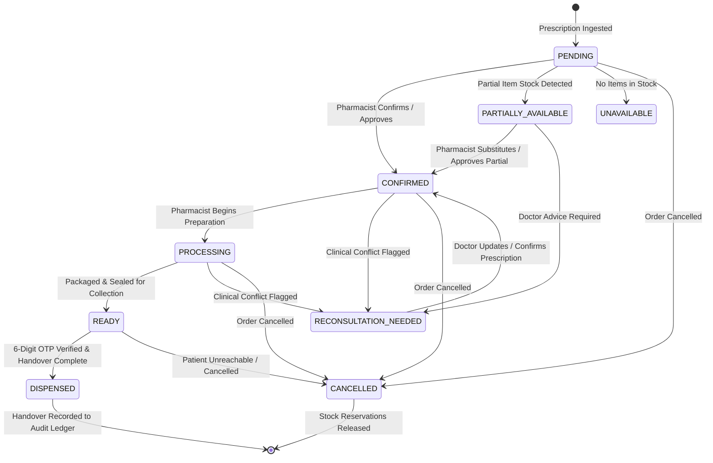

### 4.5 Handover Verification & Stock Reservation Sequence

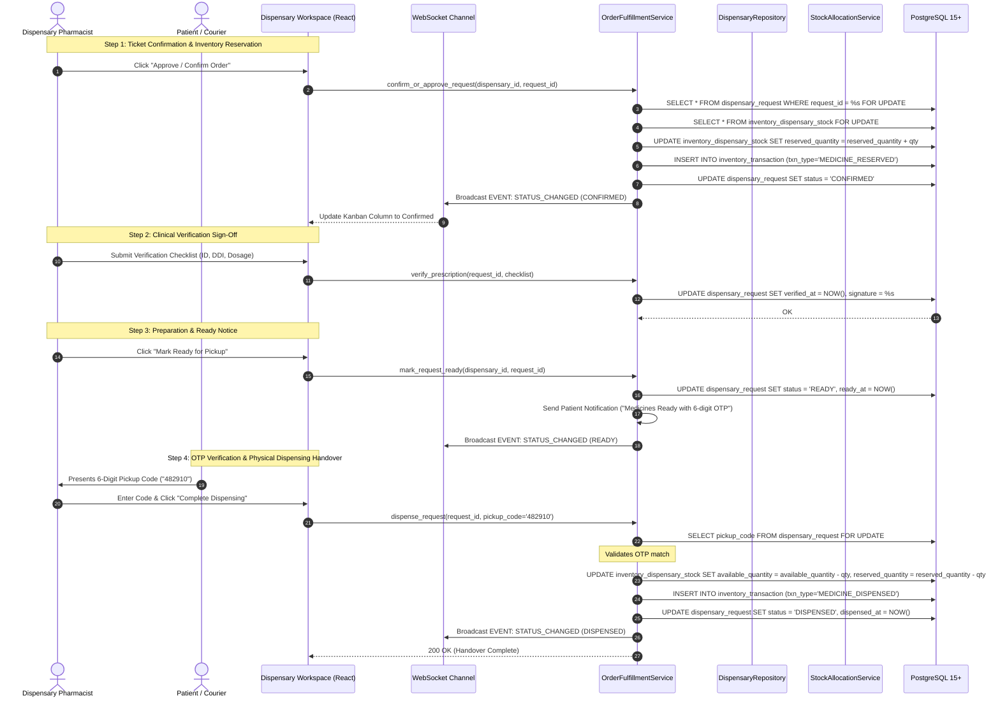

### 4.6 Endpoints & Service Delegations

| Endpoint | Method | Purpose | OOP Handler Delegation |
| :--- | :--- | :--- | :--- |
| `/api/dispensary/inventory` | `GET` | List inventory stock with free-stock calculations | `default_stock_service.get_inventory_stock()` |
| `/api/dispensary/inventory` | `POST` | Upsert medicine inventory row | `default_stock_service.add_or_update_stock()` |
| `/api/dispensary/inventory/bulk`| `POST` | Bulk upsert medicine stock | `default_stock_service.bulk_add_or_update_stock()` |
| `/api/dispensary/inventory/csv` | `POST` | Parse and import CSV stock file | `default_stock_service.import_stock_from_csv()` |
| `/api/dispensary/inventory/{id}`| `PATCH`| Partial update of stock thresholds | `default_stock_service.update_stock_partial()` |
| `/api/dispensary/queue` | `GET` | Active FIFO dispensary order queue | `default_fulfillment_service.get_dispensary_queue()` |
| `/api/dispensary/requests/{id}` | `GET` | Full order detail with patient & items | `default_fulfillment_service.get_request_detail()` |
| `/api/dispensary/requests/{id}/approve` | `POST` | Confirm ticket & reserve inventory | `default_fulfillment_service.confirm_or_approve_request()` |
| `/api/dispensary/requests/{id}/process` | `POST` | Transition ticket to processing | `default_fulfillment_service.process_request()` |
| `/api/dispensary/requests/{id}/ready` | `POST` | Mark order packaged and ready | `default_fulfillment_service.mark_request_ready()` |
| `/api/dispensary/requests/{id}/dispense`| `POST` | Validate OTP & finalize handover | `default_fulfillment_service.dispense_request()` |
| `/api/dispensary/requests/{id}/cancel` | `POST` | Cancel order & release held stock | `default_fulfillment_service.cancel_request()` |
| `/api/dispensary/requests/{id}/reconsult`| `POST`| Flag ticket for doctor reconsultation | `default_fulfillment_service.request_reconsultation()` |
| `/api/dispensary/requests/{id}/items/{item_id}` | `PATCH` | Per-item decision (substitute, partial) | `default_fulfillment_service.update_request_item_decision()` |
| `/api/dispensary/requests/{id}/verify` | `POST` | Clinical pharmacist verification sign-off | `default_fulfillment_service.verify_prescription()` |
| `/api/dispensary/dashboard` | `GET` | Real-time queue counters & alerts | `default_analytics_service.get_dashboard_stats()` |
| `/api/dispensary/analytics` | `GET` | Turnaround time & order trends | `default_analytics_service.get_dispensary_analytics()` |
| `/api/dispensary/transactions` | `GET` | Audit ledger of inventory movements | `default_stock_service.get_inventory_transactions()` |
| `/api/dispensary/ws/{id}` | `WS` | Real-time bi-directional WebSocket | `dispensary_ws_manager` & `default_dispatcher` |

---

## 5. Module 4: Patient Adherence & Medication Schedule Engine

### 5.1 Domain Overview & Objectives
Patient care within Rxify bridges prescription ingestion, personal adherence routines, and clinical doctor feedback loops:
1. **Patient-Isolated Multi-Tenancy:** Strict privacy barriers ensuring patients can only inspect and modify their own health records (`pt.user_id = %s`).
2. **Chronological Milestone Flowcharts:** Visual medication history grouped by clinical consultation events, automatically detecting drug transitions (`STARTED`, `CONTINUED`, `DISCONTINUED`, `COMPLETED`).
3. **Patient-in-the-Loop Disambiguation:** When OCR matching flags an item as `AMBIGUOUS` or `UNRESOLVED`, the patient selects the exact drug from fuzzy candidates, updating the catalog mapping and persisting self-learned synonyms in `medicine_alias`.
4. **Automated Dispensary Re-Evaluation:** When a patient clarifies an unmapped medicine, the dispensary fulfillment order automatically updates and triggers stock availability checks.
5. **Doctor Connection Lifecycle:** Outgoing consultation requests with status progression (`pending` $\rightarrow$ `active` or `rejected`).
6. **Active Course Status Controls:** Direct patient controls to mark ongoing treatments as `ACTIVE`, `DISCONTINUED`, or `COMPLETED` with date and reason tracking.

### 5.2 Domain Entities (`services/patient_care/domain.py`)
- **`PatientStats`:** Aggregate summary metrics: `patient_id`, `patient_code`, `rx_count`, `pending_requests`, `active_shares`.
- **`DoctorProfile`:** Public clinician profile: `doctor_id`, `doctor_code`, `display_name`, `specialty`, `experience_years`.
- **`TimelineMedication`:** Line item tracking `current_medication_id`, `dosage`, `frequency`, `duration`, `start_date`, `end_date`, `effective_status`, and milestone linkage.
- **`TimelineMilestone`:** Chronological event node containing consultation date, prescribing physician, diagnoses, and medication roster.
- **`FlowchartLink`:** Directed graph edge tracking a drug's trajectory between milestone nodes (`STARTED`, `CONTINUED`, `DISCONTINUED`).

### 5.3 Modular OOP Package Architecture
```
services/patient_care/
├── __init__.py           # Public exports & singletons
├── domain.py             # PatientStats, DoctorProfile, TimelineMilestone, FlowchartLink
├── repository.py         # PatientRepository (Parameterized SQL for patient domain)
├── timeline_service.py   # MedicationTimelineService (Graph milestone synthesis & backfill)
└── care_service.py       # PatientCareService (Clarification, doctor linking, status updates)

services/patient.py       # Facade layer delegating to services.patient_care
```

### 5.4 Patient Clarification & Self-Learning Resolution Loop

```mermaid
flowchart TD
    classDef client fill:#064E3B,stroke:#34D399,stroke-width:2px,color:#ECFDF5
    classDef service fill:#065F46,stroke:#6EE7B7,stroke-width:2px,color:#FFFFFF
    classDef db fill:#022C22,stroke:#059669,stroke-width:2px,color:#6EE7B7
    classDef loop fill:#047857,stroke:#A7F3D0,stroke-width:2px,color:#FFFFFF

    CLI["Patient Portal UI"]:::client -->|GET /api/patient/prescriptions/{id}| DET["PatientCareService<br/>get_my_prescription_detail()"]:::service
    DET -->|"Medication: match_status='AMBIGUOUS'"| AMB["Patient Review Required"]:::client

    AMB -->|GET /api/patient/medicine-candidates| CAND["PatientCareService<br/>get_medicine_candidates()"]:::service
    CAND -->|pg_trgm Ranked Drug List| AMB

    AMB -->|POST /api/patient/resolve-medicine (medicine_id)| RES["PatientCareService<br/>resolve_prescription_medicine()"]:::service
    
    RES -->|1. Commit Choice| P1["UPDATE prescription_medicine<br/>SET match_status='MATCHED', patient_resolved=TRUE"]:::db
    RES -->|2. Store Self-Learned Synonym| P2["INSERT INTO medicine_alias<br/>(alias_name, medicine_id, alias_type='user_learned')"]:::loop
    RES -->|3. Trigger Dispensary Re-Evaluation| P3["DispensaryOrderFulfillmentService<br/>create_dispensary_request_for_prescription()"]:::service

    P3 -->|4. Real-Time Stock Availability Sync| WS["Dispensary Queue & Live WebSocket"]:::client
```

### 5.5 Medication Adherence Timeline & Milestone Generation Sequence

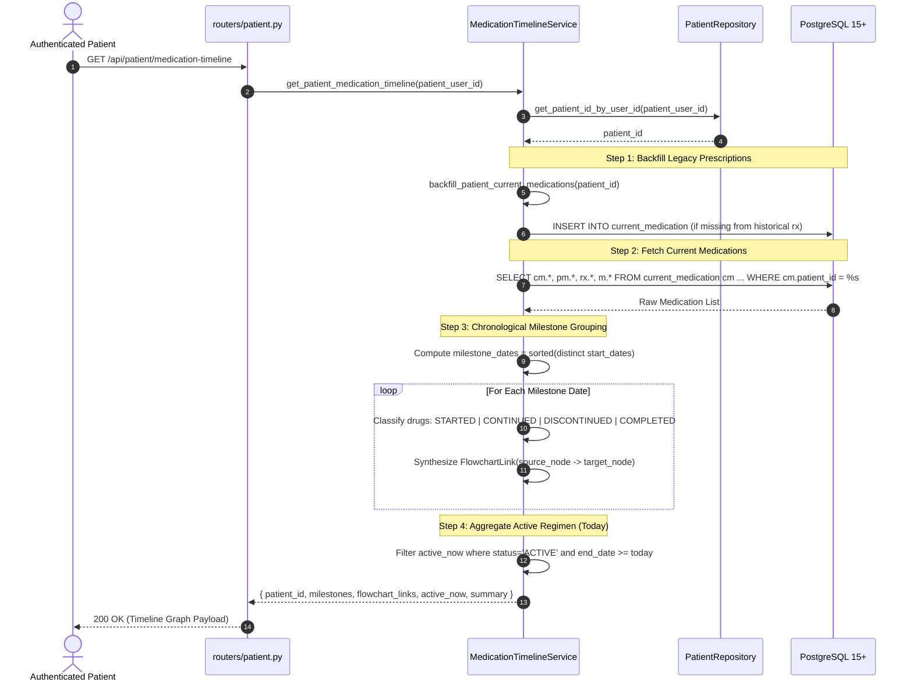

### 5.6 Endpoints & Service Delegations

| Endpoint | Method | Purpose | Handler Delegation |
| :--- | :--- | :--- | :--- |
| `/api/patient/stats` | `GET` | Dashboard overview counts | `default_care_service.get_patient_stats()` |
| `/api/patient/prescriptions` | `GET` | List patient's prescriptions | `default_care_service.get_my_prescriptions()` |
| `/api/patient/prescriptions/{id}` | `GET` | Prescription details with drugs & status | `default_care_service.get_my_prescription_detail()` |
| `/api/patient/doctor/lookup/{id}` | `GET` | Look up clinician public details | `default_care_service.lookup_doctor()` |
| `/api/patient/request-doctor` | `POST` | Send doctor consultation request | `default_care_service.send_doctor_request()` |
| `/api/patient/my-requests` | `GET` | List outgoing doctor requests | `default_care_service.get_my_requests()` |
| `/api/patient/my-doctor` | `GET` | Fetch actively assigned doctor | `default_care_service.get_assigned_doctor()` |
| `/api/patient/medicine-candidates`| `GET` | Get ranked options for ambiguous drug | `default_care_service.get_medicine_candidates()` |
| `/api/patient/resolve-medicine` | `POST` | Patient confirms drug match & learns alias | `default_care_service.resolve_prescription_medicine()` |
| `/api/patient/medication-timeline` | `GET` | Interactive health milestone flowchart | `default_timeline_service.get_patient_medication_timeline()` |
| `/api/patient/current-medications/{id}/status` | `PATCH` | Update course status (ACTIVE/STOPPED) | `default_care_service.update_patient_medication_status()` |
| `/api/patient/timeline-prescriptions` | `GET` | 3D spatial chronological prescription records | `default_timeline_service.get_patient_timeline_prescriptions()` |

---

## 6. Module 5: Clinical Appointments & Consultation Scheduling

### 6.1 Domain Overview & Objectives
The Consultation Scheduling module coordinates patient appointment discovery and clinical calendar allocations:
1. **Clinician Discovery:** Fast search across doctors by medical specialization and qualifications.
2. **Smart Time-Period Matching:** Automatic classification into `morning` (06:00–12:00), `afternoon` (12:00–17:00), and `evening` (17:00–21:00) windows.
3. **Graceful Fallback Scoring:** If no exact matches are available in the preferred time period, the nearest open slots are returned with `suggested=True` to prevent empty dead-ends.
4. **Race-Free Concurrency Control:** Employs PostgreSQL row-level locks (`SELECT ... FROM appointment_slot WHERE slot_id = %s FOR UPDATE`) during booking to ensure that parallel users cannot overbook slot capacity (`max_patients`).
5. **Double-Booking Prevention:** Validates that the patient does not already hold an active booking in the same slot.
6. **Patient-Isolated History & Cancellation:** Enables patients to view upcoming or past consultations and cancel `BOOKED` or `CONFIRMED` visits.

### 6.2 Domain Entities (`services/appointments/domain.py`)
- **`TimePeriod` (Enum):** `MORNING`, `AFTERNOON`, `EVENING`, `ANY`.
- **`AppointmentStatus` (Enum):** `BOOKED`, `CONFIRMED`, `COMPLETED`, `CANCELLED`, `NO_SHOW`.
- **`DoctorSearchResult`:** Doctor profile metadata (`doctor_id`, `doctor_name`, `specialization`, `qualification`, `experience_years`).
- **`AppointmentSlot`:** Capacity-tracked calendar slot (`slot_id`, `slot_date`, `start_time`, `end_time`, `max_patients`, `remaining_capacity`, `clinic_name`, `suggested`).
- **`AppointmentRecord`:** Patient booking entity (`appointment_id`, `patient_id`, `doctor_id`, `slot_date`, `status`, `reason_for_visit`).

### 6.3 Modular OOP Package Architecture
```
services/appointments/
├── __init__.py           # Public exports & singletons
├── domain.py             # TimePeriod, AppointmentStatus, AppointmentSlot, DoctorSearchResult
├── slot_matcher.py       # SmartSlotMatcher (Window math & fallback recommendation scoring)
├── repository.py         # AppointmentRepository (SQL data access & row-level FOR UPDATE locks)
└── appointment_service.py# AppointmentBookingService (Orchestrator for search, matching & booking)

services/patient_appointment.py # Backwards-compatible facade delegating to services.appointments
```

### 6.4 Smart Slot Matching & Fallback Scoring Pipeline

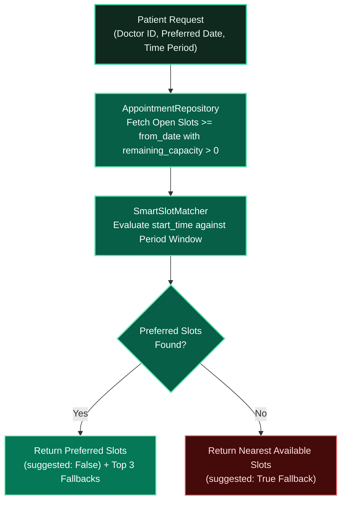

### 6.5 Race-Free Appointment Booking Sequence

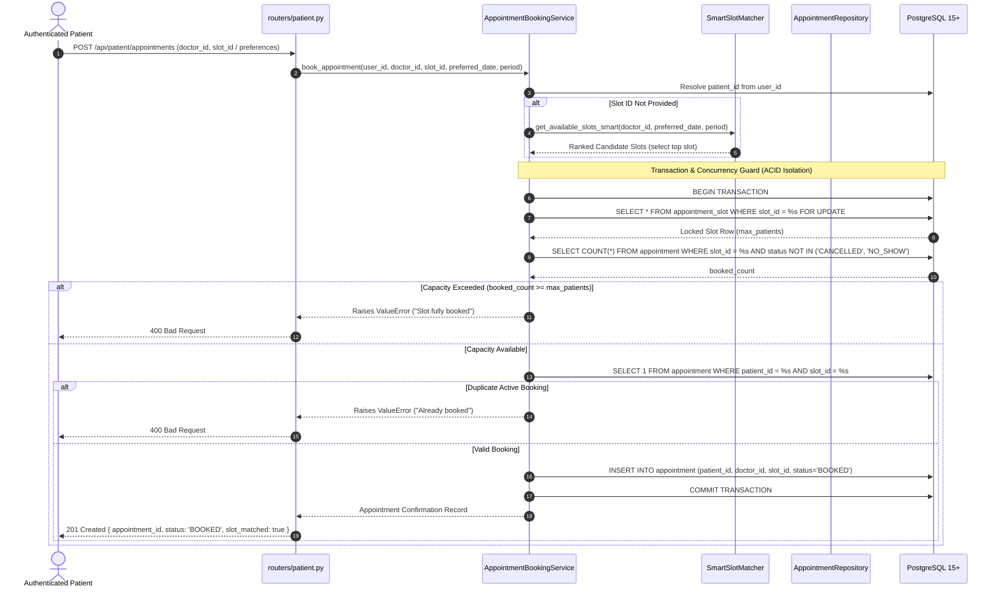

### 6.6 Endpoints & Service Delegations

| Endpoint | Method | Purpose | Handler Delegation |
| :--- | :--- | :--- | :--- |
| `/api/patient/appointments/doctors` | `GET` | Browse doctors by specialty | `default_appointment_service.search_doctors_by_specialty()` |
| `/api/patient/appointments/doctors/{id}/slots`| `GET` | Smart slot matching with fallbacks | `default_appointment_service.get_available_slots_smart()` |
| `/api/patient/appointments` | `POST` | Book consultation with concurrency lock | `default_appointment_service.book_appointment()` |
| `/api/patient/appointments` | `GET` | List patient's booked consultations | `default_appointment_service.get_patient_appointments()` |
| `/api/patient/appointments/{id}` | `DELETE`| Cancel booked consultation | `default_appointment_service.cancel_appointment()` |

---

## 7. Module 6: Doctor Practice & Hospital Enterprise Operations

### 7.1 Domain Overview & Objectives
Clinical operations in Rxify unify multi-tenant institutional hospital governance with independent doctor practice workflows:
1. **Multi-Hospital Affiliated Clinician Roster:** Hospitals register clinicians into a localized directory (`hospital_doctor`), linking doctors without duplicating clinician records across institutions.
2. **Federated Patient Code EHR Ingress:** Doctors and hospitals can look up any patient using their unique public alphanumeric identifier (`patient_code`), accessing longitudinal historical prescriptions, active medications, and consultation notes across the entire healthcare network.
3. **Immutable HIPAA-Compliant Access Audit Trail:** Every retrieval of sensitive patient health records or appointment creation by a hospital records a non-repudiable audit event in `audit_log` (`hospital_id`, `action`, `entity_type`, `entity_id`, `details`, `created_at`).
4. **Institutional Slot Allocation & Multi-Tenant Scheduling:** Hospital administrators manage consultation slots (`appointment_slot`) on behalf of their affiliated doctors, enforcing clinic room assignment and booking capacity.
5. **Doctor-Scoped Privacy & Caseload Isolation:** Clinicians can only inspect medical details and prescriptions for patients actively assigned to their practice (`patient_doctor.status = 'active'`).
6. **Patient Connection Request Triage:** Clinicians review inbound patient connection requests (`pending`), with full workflow authority to accept (`active`) or reject (`rejected`).

### 7.2 Domain Entities (`services/clinical_ops/domain.py`)
- **`HospitalProfile`:** Healthcare institution entity: `hospital_id`, `name`, `email`, `phone`, `address`, `city`, `state`, `registration_number`, `status`.
- **`AffiliatedDoctor`:** Clinician attached to hospital: `doctor_id`, `doctor_name`, `doctor_email`, `specialization`, `qualification`, `department`, `active_patient_count`.
- **`PatientEHRSummary`:** Public patient identification record: `patient_id`, `patient_code`, `full_name`, `date_of_birth`, `blood_group`, `total_prescriptions`.
- **`DoctorDashboardStats`:** Clinician operational KPIs: `patient_count`, `rx_count`, `pending_requests`, `upcoming_followups`.
- **`HospitalDashboardData`:** Institutional governance metrics: `total_accesses`, `unique_patients_accessed`, `accesses_today`, `recent_activity`.

### 7.3 Modular OOP Package Architecture
```
services/clinical_ops/
├── __init__.py           # Public exports & singletons
├── domain.py             # HospitalProfile, AffiliatedDoctor, PatientEHRSummary, DoctorDashboardStats
├── repository.py         # ClinicalOpsRepository (SQL data access for doctor & hospital operations)
├── hospital_service.py   # HospitalEnterpriseService (Hospital profiles, EHR lookup, audit logging, slots)
└── doctor_service.py     # DoctorPracticeService (Prescription caseload, patient triage, profile)

services/hospital.py      # Backwards-compatible facade delegating to services.clinical_ops
services/doctor.py        # Backwards-compatible facade delegating to services.clinical_ops
```

### 7.4 Multi-Tenant Clinician Roster & Federated Patient EHR Ingress

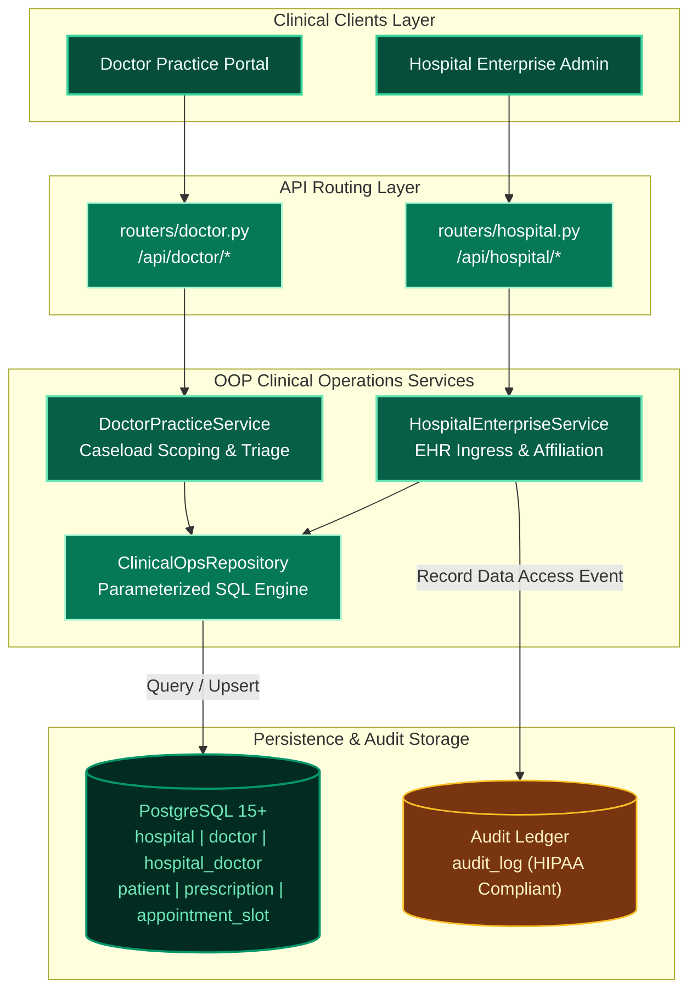

### 7.5 Hospital-Mediated Patient Booking & Audit Lifecycle Sequence

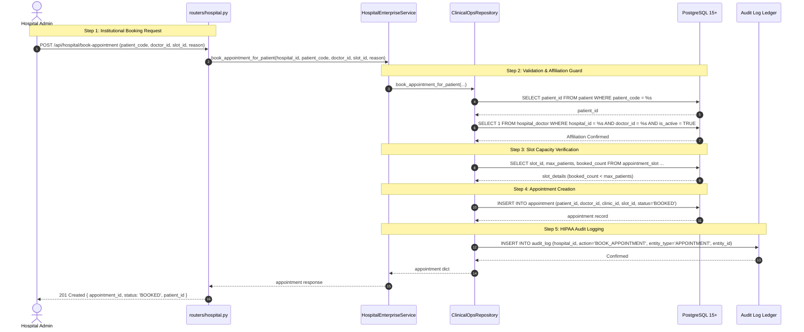

### 7.6 Endpoints & Service Delegations

| Endpoint | Method | Purpose | Handler Delegation |
| :--- | :--- | :--- | :--- |
| `/api/doctor/stats` | `GET` | Doctor dashboard operational KPIs | `default_doctor_service.get_stats()` |
| `/api/doctor/my-patients` | `GET` | List assigned patient roster | `default_doctor_service.get_patients()` |
| `/api/doctor/my-prescriptions` | `GET` | Paginated doctor-scoped prescriptions | `default_doctor_service.get_prescriptions()` |
| `/api/doctor/my-prescriptions/{id}` | `GET` | Detail of doctor's prescription | `default_doctor_service.get_prescription_detail()` |
| `/api/doctor/patient-prescriptions` | `GET` | All prescriptions for an assigned patient | `default_doctor_service.get_patient_prescriptions_scoped()` |
| `/api/doctor/connection-requests` | `GET` | List pending patient connection requests | `default_doctor_service.get_pending_requests()` |
| `/api/doctor/connection-requests/{id}`| `POST` | Accept or reject connection request | `default_doctor_service.respond_to_request()` |
| `/api/doctor/lookup-patient` | `GET` | Lookup patient via public patient_code | `default_doctor_service.lookup_patient_by_code()` |
| `/api/doctor/connect-patient` | `POST` | Directly link patient to practice | `default_doctor_service.connect_patient()` |
| `/api/doctor/profile` | `PUT` | Update clinician profile & specialty | `default_doctor_service.update_profile()` |
| `/api/hospital/register` | `POST` | Register hospital enterprise account | `default_hospital_service.register_hospital()` |
| `/api/hospital/login` | `POST` | Authenticate hospital credentials | `default_auth_service.authenticate_hospital()` |
| `/api/hospital/dashboard` | `GET` | Aggregate enterprise activity metrics | `default_hospital_service.get_dashboard_data()` |
| `/api/hospital/lookup-patient` | `GET` | Lookup patient summary by patient_code | `default_hospital_service.lookup_patient_by_code()` |
| `/api/hospital/patient-prescriptions` | `GET` | Access patient prescriptions & audit log | `default_hospital_service.get_patient_prescriptions()` |
| `/api/hospital/patient-current-medications`| `GET` | Access active patient medications | `default_hospital_service.get_patient_current_medications()` |
| `/api/hospital/doctors` | `GET` | List hospital's affiliated clinicians | `default_hospital_service.get_hospital_doctors()` |
| `/api/hospital/doctors/affiliate` | `POST` | Affiliate doctor to hospital roster | `default_hospital_service.affiliate_doctor()` |
| `/api/hospital/doctors/{id}` | `DELETE`| Remove doctor affiliation | `default_hospital_service.remove_doctor_affiliation()` |
| `/api/hospital/doctors/{id}/patients` | `GET` | View patients under affiliated doctor | `default_hospital_service.get_doctor_patients_for_hospital()` |
| `/api/hospital/slots` | `POST` | Create appointment slot for doctor | `default_hospital_service.create_slot_for_doctor()` |
| `/api/hospital/slots/{id}` | `PATCH` | Update doctor slot time/capacity | `default_hospital_service.update_slot()` |
| `/api/hospital/slots/{id}` | `DELETE`| Delete doctor slot | `default_hospital_service.delete_slot()` |
| `/api/hospital/book-appointment` | `POST` | Hospital books appointment for patient | `default_hospital_service.book_appointment_for_patient()` |


